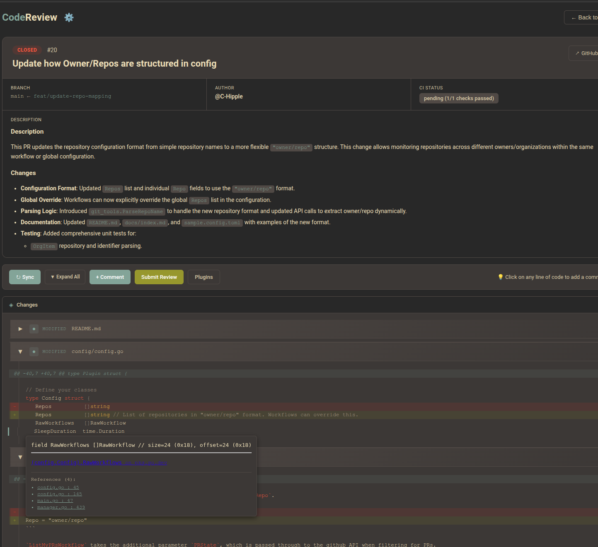
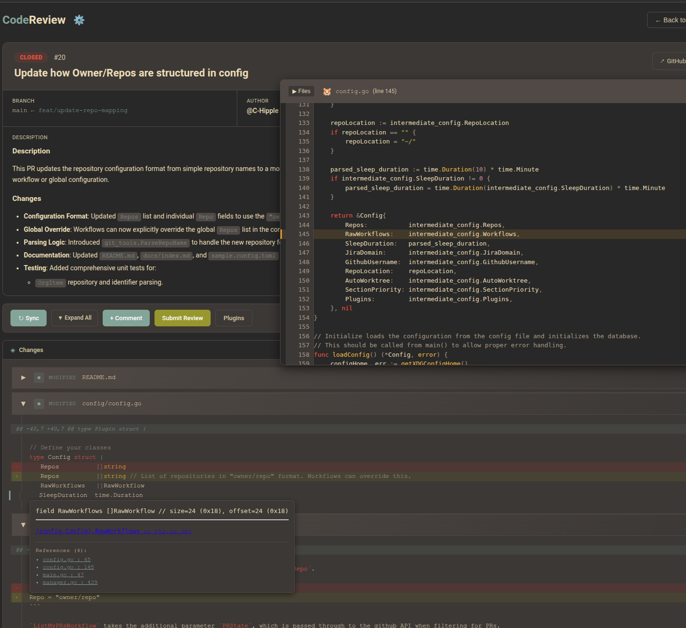
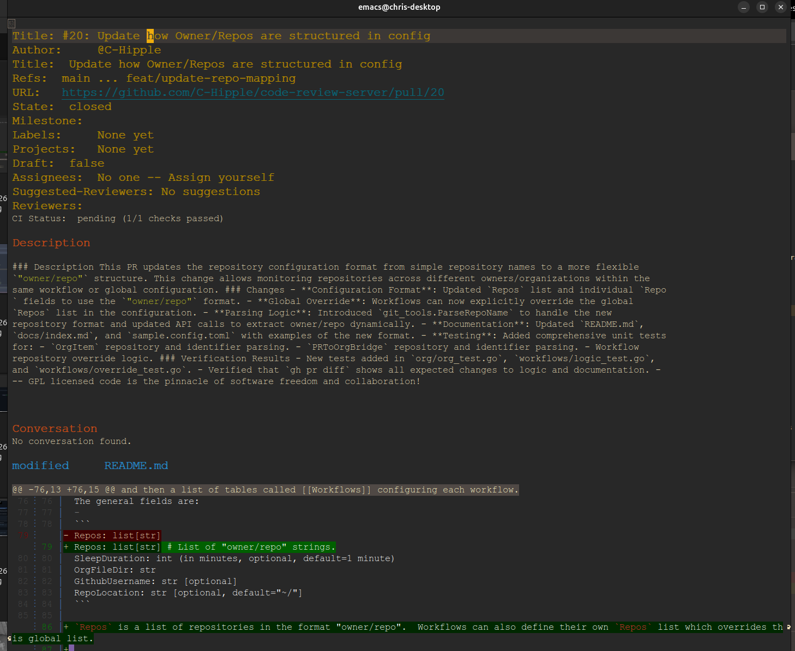
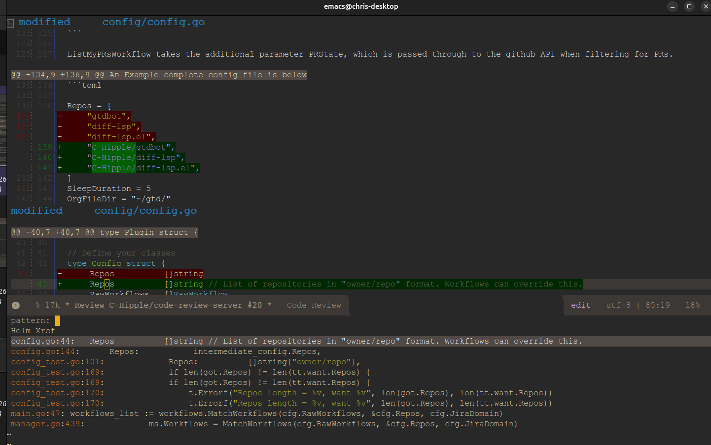

# Reviewing Code

Code Review Server makes the review process fast, customizable, and integrated with your local environment.

## Workflow

From your client (Web or Emacs), you can jump directly from the Pull Request list into a dedicated code review view.

### Fast and Cached
All data is cached locally. This means when you open a review, it loads nearly instantly. You don't have to wait for GitHub API calls to fetch diffs or comments every time you switch files or reviews.

### Fully Functional
The review environment is fully functional. You can:
- **View Diffs**: See changes with syntax highlighting.
- **Read Comments**: View existing comments from other reviewers inline with the code.
- **Add Comments**: Start a review, add pending comments, and submit them all at once.
- **Reply to Threads**: Engage in discussions directly from the interface.

### Sections Update As Soon As You Submit
Submitting a review re-runs that pull request through the filters of every
workflow that targets its repository, so the dashboard reflects the review
right away instead of at the next background cycle. A PR drops out of a
"needs review" section the moment its filters stop matching, and appears in
any section whose filters now match it.




## LSP Integration
Because the server runs locally and can manage git worktrees, it can integrate with Language Server Protocols (LSP). This allows features like:
- **Go to Definition**: Jump to symbols in the PR code.
- **Hover Information**: See types and documentation.
- **Find References**: Explore codebase usage.





This gives you the power of your full IDE environment while reviewing code, something that is often missing from web-based review tools.

A review is a diff, not a file, and language servers only understand files. The bridge is [diff-lsp](https://github.com/C-Hipple/diff-lsp), a separate project that sits between your client and your language servers:

```
Editor / web client -> diff-lsp -> [gopls, rust-analyzer, pylsp, ...]
```

To the client it looks like an ordinary language server. To the backends it looks like an ordinary client working on the real checkout of the PR's branch. diff-lsp maps each line of the diff to the matching line of the real source file, asks the backend, and maps the answer back onto the diff. It supports hover, go to definition, go to type definition, find references, document symbols (imenu / breadcrumbs) and diagnostics. Because the backends read the whole checkout, answers aren't limited to the lines the diff shows. Where a result lands on a line the diff does show, diff-lsp also returns the diff location, so "find references" can jump around inside the review.

Code Review Server's part is supplying that checkout (see [AutoWorktree](#the-checkout)) and the PR's diff; diff-lsp and the editor integration are installed separately.

### Setting up diff-lsp

1. **Install diff-lsp.** It is written in Rust, so you need a [Rust toolchain](https://rustup.rs). Either install straight from GitHub:

    ```bash
    cargo install --git https://github.com/C-Hipple/diff-lsp
    ```

    or clone it and run `cargo install --path .` from the checkout. Make sure `~/.cargo/bin` is on your `PATH`, and check with `which diff-lsp`.

2. **Install the language servers for the code you review.** diff-lsp starts one backend per language it finds in the diff — `gopls` for Go, `rust-analyzer` for Rust, `pylsp` for Python and so on — and starts another on demand if a later diff brings in a new language. A missing backend isn't fatal: diff-lsp keeps running without it and logs a warning such as `pylsp not found; Python features disabled`.

3. **Point the server at your clones** (see below), then set up your client:
    - [Emacs](#emacs-diff-lspel)
    - [Web client](#web-client): nothing to configure.

diff-lsp's own documentation, including every `initializationOptions` setting, is at [diff-lsp.readthedocs.io](https://diff-lsp.readthedocs.io/en/latest/).

### The checkout

The backends need the PR's code on disk. In `~/.config/codereviewserver.toml`:

```toml
RepoLocation = "~/code"   # where your clones live (default "~/")
AutoWorktree = true       # let the server check out each PR's branch for you
```

- **RepoLocation** is the directory holding your clones of the repositories you review, as `<RepoLocation>/<repo>`.
- **AutoWorktree** makes the server create a git worktree for each PR, so the language servers see the PR's branch rather than whatever you have checked out. The PR's metadata reports it as `worktree_path`, and clients pass it to diff-lsp as the `Worktree:` header. Without it the language servers can only read your clone as it stands, which won't match the PR unless you have its branch checked out yourself.

If a repository isn't cloned under `RepoLocation`, there is nothing for the backends to read and LSP is switched off for that review — the clients say so rather than failing. See [Configuration](configuration.md) for both settings.

### Emacs (diff-lsp.el)

[diff-lsp.el](https://github.com/C-Hipple/diff-lsp.el) is the Emacs side. It makes the review buffer a document an LSP client can open: it writes the buffer to a temp file with a few header lines (`Project`, `Root`, `Buffer`, `Type`) that tell diff-lsp where the code is, registers `diff-lsp` as an [lsp-mode](https://emacs-lsp.github.io/lsp-mode/) server for those buffers, and adjusts line and column positions for the header and for the `+`/`-` column of the diff. The same package serves `magit-status` buffers.

Requirements: `diff-lsp` on your `PATH` (above), and `lsp-mode`. The package also uses `projectile` (to find the project root) and `evil`, so have both installed.

1. **Install the package.** It isn't on MELPA; install it from GitHub with your package manager. With Spacemacs, add this to `dotspacemacs-additional-packages`:

    ```elisp
    (diff-lsp :location (recipe
                         :fetcher github
                         :repo "C-Hipple/diff-lsp.el"
                         :files ("*.el")))
    ```

    With `straight.el`: `(straight-use-package '(diff-lsp :type git :host github :repo "C-Hipple/diff-lsp.el"))`.

2. **Enable it,** in your init file (or call it by hand when you want it):

    ```elisp
    (diff-lsp-setup-advice)
    ```

    `(diff-lsp-remove-advice)` undoes it.

3. **Open a review** (`crs-get-review`, or `crs-start-review-at-point` from the list). The review buffer is in `my-code-review-mode`, one of the modes diff-lsp.el activates by default, so lsp-mode starts diff-lsp for it. Hover, go to definition, find references and the rest then work on the diff lines with your usual lsp-mode commands (`lsp-find-definition`, `lsp-find-references`, `lsp-describe-thing-at-point`, ...).

The Emacs client's part is the header of each review buffer: it writes a `Worktree:` line naming the PR's worktree, which diff-lsp reads to start the backends in the right checkout.

Two variables adjust diff-lsp.el:

```elisp
;; Where the temp files go. diff-lsp looks in /tmp by default, so change
;; this only if you also point diff-lsp somewhere else.
(setq diff-lsp-tempfile-dir "/tmp/")

;; Which major modes get diff-lsp. The default is code-review-mode and
;; my-code-review-mode; add magit-status-mode to use it in Magit too.
(setq diff-lsp-major-modes '(code-review-mode my-code-review-mode magit-status-mode))
```

If you set `diff-lsp-major-modes` yourself, keep `my-code-review-mode` in it or the Emacs client's review buffers lose LSP.

**Diagnostics.** diff-lsp republishes your backends' errors and warnings on the diff lines, so lsp-mode and flycheck show them in the review. By default only problems on *added* lines appear — what the PR introduced. To change that, set `initializationOptions` on the registered client: `{"diagnostics": "visible"}` also covers unchanged context lines, and `{"diagnostics": "off"}` turns them off. Likewise `{"diffLocations": "both" | "prefer" | "off"}` decides whether find-references returns locations inside the review, in the real files, or both (the default).

**Troubleshooting.**
- `M-x diff-lsp--tail-logs` follows `~/.diff-lsp.log`.
- `M-x diff-lsp-test-offset` in a review buffer shows which tempfile line your cursor maps to. If answers are off by a line, the cached header count may be stale: `M-x diff-lsp--invalidate-header-cache` and try again.
- Nothing happens at all: check that `which diff-lsp` works from the environment Emacs was started in (a GUI Emacs often doesn't see your shell's `PATH`; `exec-path-from-shell` fixes that), and that the backend for the file's language is installed.

### Web client

The [web client](clients.md#web-client-bun) needs no setup beyond installing diff-lsp. At startup it looks for `diff-lsp` and the usual language servers on your `PATH`; if `diff-lsp` is there and the repository is cloned locally, clicking a code line in a diff opens a popover with hover text, definitions, type definitions and references. It prepares the diff for diff-lsp the same way diff-lsp.el does, and shares running language servers between reviews of the same workspace so reopening a review doesn't re-index it. Without diff-lsp the diff header says "LSP not active"; without a local clone it says "Repo not found locally. LSP disabled." The full behavior is in [Web Client Features](web_client_features.md#311-lsp-integration-uselspts-lspts-lsppopovertsx).
